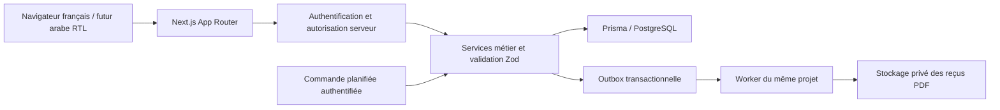

# Architecture technique proposée

## Périmètre

Une école, une base PostgreSQL, un monolithe modulaire Next.js. Administration, secrétariat et espace professeur ; espace parent ultérieur. Les extensions multi-écoles ne sont pas incluses dans ce modèle. Années scolaires configurables, aucune donnée scolaire ou financière fictive dans les indicateurs de production.

## Composants et flux



Server Components pour les lectures et la structure ; composants client limités aux formulaires, tableaux, calendrier et graphiques. Server Actions pour les mutations internes et Route Handlers pour Auth.js, téléchargement et intégrations. Chaque point d’entrée appelle les mêmes services : validation Zod, identité, permission, périmètre d’accès, transaction, audit. Le navigateur ne décide jamais des permissions ni du montant restant.

Modules : identité, référentiels scolaires, élèves/responsables, professeurs, groupes/inscriptions, planning, présences, abonnements, facturation, paiements/reçus, rémunérations, rapports, paramètres/audit. Les services échangent des identifiants ou DTO, pas des composants React. Aucun appel externe ou rendu PDF dans une transaction SQL.

Le worker appartient au monolithe et partage ses services ; il traite l’outbox, les PDF et la génération périodique. Plusieurs exécutions sont possibles grâce à l’idempotence, au verrouillage des travaux et à des tentatives bornées. Une commande manuelle autorisée doit permettre de relancer un mois sans doublon.

## Socle et compatibilité

Base proposée : Node.js 24 LTS, Next.js App Router 16, React 19, TypeScript 5.9 strict, PostgreSQL 17, Prisma ORM 7 avec adaptateur PostgreSQL. Les versions correctives exactes et le lockfile seront fixés en phase 2 après vérification des peer dependencies, du build et des tests d’intégration. Aucun numéro correctif non vérifié n’est présenté comme acquis.

Next.js documente Node ≥ 20.9 et TypeScript ≥ 5.1 ; Prisma 7 demande notamment Node 24 ou une branche compatible et TypeScript ≥ 5.4. Ces minima rendent le socle proposé cohérent, sans constituer une preuve de compatibilité de toutes les dépendances : [Next.js installation](https://nextjs.org/docs/app/getting-started/installation), [Prisma 7 prérequis](https://www.prisma.io/docs/orm/v7/reference/system-requirements).

Retenir explicitement Prisma 7 : la documentation consultée présente Prisma 8 comme release candidate et décrit une API différente. Ne pas installer `prisma@latest` sans contrôle : [statut de publication Prisma](https://www.prisma.io/docs/orm/release-status). Le schéma utilise `prisma-client`, un output explicite et une datasource PostgreSQL ; l’URL sera portée par `prisma.config.ts` en phase 2 : [migration vers Prisma 7](https://www.prisma.io/docs/guides/upgrade-prisma-orm/v7).

Tailwind CSS, composants shadcn/ui versionnés dans le dépôt, Zod, React Hook Form, TanStack Table, FullCalendar et Recharts sont les choix demandés. Vitest pour logique et intégration, Playwright pour parcours et autorisations, Docker pour exécution reproductible. Les combinaisons exactes seront validées ensemble ; ne pas traiter les dernières versions individuelles comme une matrice déjà testée. Calendrier limité aux fonctionnalités standard ; toute fonctionnalité FullCalendar Premium nécessiterait une décision explicite.

**Point à arbitrer :** la documentation officielle Auth.js Next.js prescrit encore `next-auth@beta`. Cela entre en tension avec l’exigence de versions stables : [installation Auth.js](https://authjs.dev/getting-started/installation?framework=Next.js). Valider soit cette exception avec version exacte, soit une étude d’une intégration stable avant la phase 2. Aucun choix silencieux d’une version bêta.

Proposition d’authentification : fournisseur OIDC avec comptes réservés au personnel et sessions en base via adaptateur Auth.js, sous réserve du choix de version et du fournisseur. `AuthSession` est distinct de la séance scolaire `Session` ; l’adaptateur devra mapper ce nom. Pas d’inscription publique. Si identifiants locaux exigés : valider ce changement et documenter hachage, réinitialisation et stratégie de session compatible avec le fournisseur Credentials retenu.

## Données et intégrité

UUID internes ; codes publics uniques sans utiliser `count + 1`. DZD et montants `Decimal(14,2)`, valeurs API décimales sous forme de chaînes. Dates métier en PostgreSQL `date`, instants en `timestamptz`, affichage `fr-DZ`, JJ/MM/AAAA, fuseau **Africa/Algiers**, indépendamment du fuseau du poste. Créneaux récurrents en minutes locales + jour ISO ; matérialisation des occurrences en instants UTC. Périodes et créneaux à bornes `[début, fin)`.

Les montants encaissés, soldes et statuts sont dérivés des allocations dont le paiement est validé. Pas de colonne mutable de solde faisant autorité. Tarif convenu dans l’abonnement, montants et politique figés sur la mensualité. JSON réservé aux instantanés immuables, paramètres validés et métadonnées ; clés étrangères pour les relations métier.

Le schéma Prisma ne suffit pas aux garanties de production : contraintes SQL et protocoles de verrouillage sont spécifiés dans les règles métier. Les migrations correspondantes seront écrites et testées après validation, sans `db push` en production.

## Sécurité et permissions

| Action | ADMIN | SECRETAIRE | PROFESSEUR |
|---|---|---|---|
| Référentiels, élèves, inscriptions | Oui | Oui | Lecture minimale des élèves de ses groupes |
| Planning | Oui | Oui | Lecture de son planning |
| Présences | Toutes | Toutes | Ses séances uniquement |
| Abonnements, encaissements et reçus | Oui | Oui | Non |
| Annulation financière | Oui | Non par défaut | Non |
| Dérogation de capacité | Permission dédiée | Non par défaut | Non |
| Gestion des rôles et paramètres | Oui | Non | Non |
| Rémunérations et audit global | Oui | Non par défaut | Non par défaut |

Matrice proposée à valider. Contrôle côté serveur à chaque lecture, export et mutation, incluant les téléchargements PDF ; filtrer les objets par professeur effectif de la séance/groupe. Ne jamais se contenter de masquer un bouton. Relecture des droits actuels pour éviter des permissions périmées dans une session. Cookies HttpOnly/Secure/SameSite, contrôle d’origine/CSRF selon le transport, limitation des tentatives de connexion, TLS, secrets hors dépôt, journaux sans coordonnées personnelles ni secrets.

Audit append-only : acteur, action, cible, instant, identifiant de requête et changements minimaux. Pas de suppression de l’audit par l’application. Durées de conservation, anonymisation et hébergement à confirmer ; ne pas prétendre à une conformité réglementaire sans étude locale.

## Exploitation et sauvegardes

Environnements développement, test et production séparés. Image Node Debian slim multi-stage, utilisateur non privilégié, services web/worker/base et stockage privé. PostgreSQL non exposé publiquement. CI : format/lint, types, validation Prisma, tests, build, parcours Playwright sur base isolée, contrôle de migrations et des dépendances. Migration de déploiement exécutée une seule fois avec rôle SQL distinct ; compte applicatif sans droits DDL ni suppression des écritures protégées.

Proposition à valider : sauvegardes quotidiennes chiffrées, WAL/PITR si hébergeur compatible, copies hors hôte et sauvegarde du stockage PDF. Objectifs RPO/RTO et rétention à fixer avec l’école. Restauration dans un environnement isolé, vérification des reçus/allocations, puis exercice documenté avant mise en service et périodiquement. Les sauvegardes ne sont pas considérées fiables tant que leur restauration n’a pas été testée.

Observabilité : identifiant de corrélation, échecs de génération, tentatives concurrentes épuisées, reçus en attente, transactions lentes, santé web/worker et âge de dernière sauvegarde. Pas de données d’élèves dans les métriques.

## Structure cible des dossiers

```text
src/
  app/
    (auth)/connexion/
    (gestion)/{dashboard,eleves,professeurs,groupes,matieres,planning,
               presences,abonnements,paiements,rapports,parametres}/
    (professeur)/mes-seances/
    api/{auth,receipts}/
  modules/
    identity/ school/ students/ teachers/ groups/ scheduling/
    attendance/ subscriptions/ billing/ payments/ compensation/ reporting/
    # Dans chaque module : schemas, services, queries, repositories, ui
  components/{ui,layout,forms}/
  lib/{db,auth,money,dates,errors,logging}/
  generated/prisma/
  i18n/{fr,ar}/
  jobs/{generate-charges,render-receipts}/
prisma/{schema.prisma,migrations,seed.ts}
tests/{unit,integration,e2e,fixtures}/
docs/{phase-1,adr,operations}/
.agents/skills/
prisma.config.ts
compose.yaml
Dockerfile
```

Cette arborescence est une proposition, pas des fichiers applicatifs créés. Propriétés CSS logiques et textes externalisés dès la phase 2 pour préparer RTL ; traduction arabe ultérieure.
