# Diagramme entité-relation

Les traits indiquent les clés étrangères ; les contraintes temporelles et interlignes supplémentaires sont décrites dans les règles métier. Le fichier Prisma est la référence détaillée pour les champs et index.

```mermaid
erDiagram
  User ||--o{ UserRole : possede
  Role ||--o{ UserRole : attribue
  Role ||--o{ RolePermission : autorise
  Permission ||--o{ RolePermission : definit
  User ||--o{ Account : identites
  User ||--o{ AuthSession : connexions
  User o|--o| Teacher : profil
  User ||--o{ AuditLog : effectue
  Student ||--o{ StudentGuardian : responsables
  Guardian ||--o{ StudentGuardian : enfants
  Student ||--o{ StudentAcademicYear : scolarite
  AcademicYear ||--o{ StudentAcademicYear : regroupe
  SchoolLevel ||--o{ StudentAcademicYear : classe
  AcademicYear ||--o{ SchoolClosure : fermetures
  Teacher ||--o{ TeacherSubject : enseigne
  Subject ||--o{ TeacherSubject : habilitation
  Subject ||--o{ Group : matiere
  SchoolLevel ||--o{ Group : niveau
  AcademicYear ||--o{ Group : annee
  Teacher ||--o{ Group : principal
  Group ||--o{ PricingPlan : tarifs_versions
  Student ||--o{ Enrollment : rejoint
  StudentAcademicYear ||--o{ Enrollment : inscrit
  Group ||--o{ Enrollment : accueille
  User o|--o{ Enrollment : deroge_capacite
  Enrollment o|--o{ Enrollment : transfert_depuis
  Enrollment ||--o{ Subscription : contrats_dates
  PricingPlan ||--o{ Subscription : tarif_source
  BillingPolicy ||--o{ Subscription : politique
  Subscription ||--o{ SubscriptionSuspension : pauses
  Subscription ||--o{ MonthlyCharge : genere
  BillingPolicy ||--o{ MonthlyCharge : version_figee
  Student ||--o{ Payment : verse
  User ||--o{ Payment : encaisse
  User o|--o{ Payment : annule
  Payment ||--o{ PaymentAllocation : ventile
  MonthlyCharge ||--o{ PaymentAllocation : recoit
  Payment ||--o| Receipt : justifie
  Teacher ||--o{ TeacherAvailability : disponibilites
  Teacher ||--o{ TeacherAvailabilityException : exceptions
  Group ||--o{ ScheduleRule : recurrrences
  Teacher ||--o{ ScheduleRule : programme
  Room ||--o{ ScheduleRule : accueille
  ScheduleRule o|--o{ Session : materialise
  Group ||--o{ Session : seances
  Teacher ||--o{ Session : assure
  Room ||--o{ Session : lieu
  Session ||--o{ Attendance : emargement
  Student ||--o{ Attendance : presence
  Enrollment ||--o{ Attendance : droit_de_presence
  User ||--o{ Attendance : saisit
  Teacher ||--o{ TeacherRate : baremes
  Teacher ||--o{ TeacherCompensation : remuneration
  Session ||--o{ TeacherCompensation : realisee
  TeacherRate ||--o{ TeacherCompensation : tarif_fige
  Settings {
    int id PK
    string schoolName
    string timezone
    json configuration
  }
  OutboxEvent {
    uuid id PK
    string deduplicationKey UK
    string aggregateId
    datetime processedAt
  }
  VerificationToken {
    string identifier
    string token UK
    datetime expires
  }
```

`Settings` est un singleton. `OutboxEvent` référence un agrégat par identifiant logique car il couvre plusieurs types ; ses événements sont créés avec l’écriture métier dans la même transaction. `VerificationToken` est une table technique d’authentification sans FK utilisateur. Les allocations ne relient jamais deux élèves différents, règle vérifiée en transaction et par contrainte différée SQL.

Les sommes reçues, le solde restant et NON_PAYE/PARTIEL/PAYE/EN_RETARD sont des données calculées. Elles ne figurent donc pas comme états persistés indépendants sur `MonthlyCharge`.
